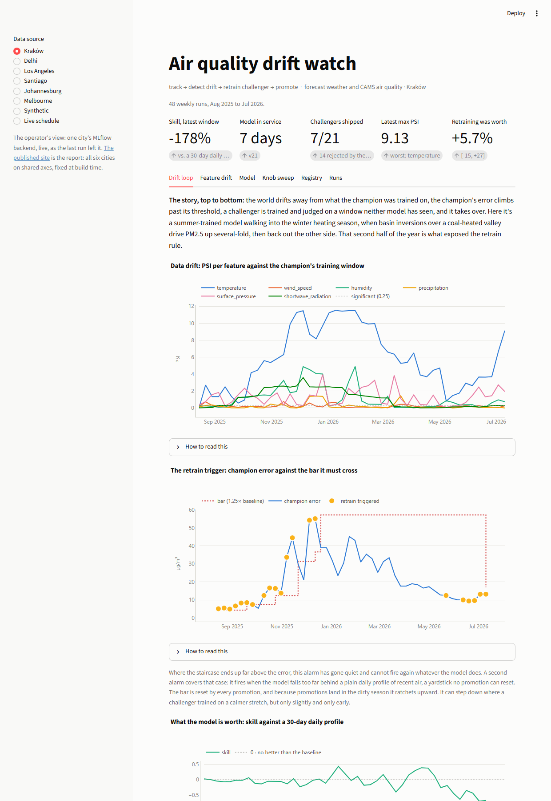
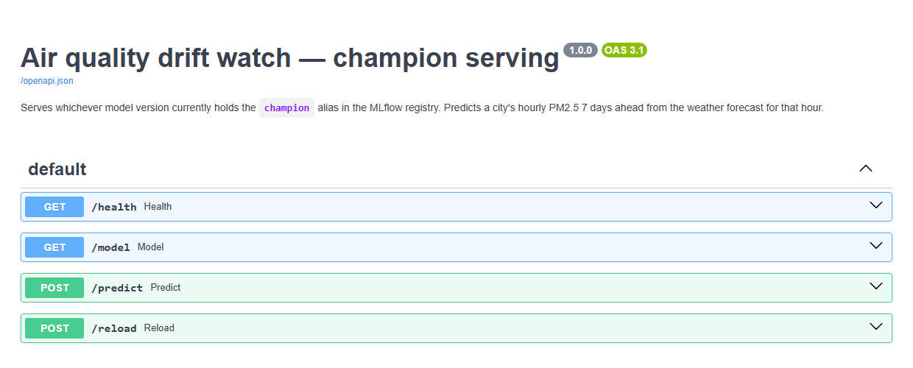

# Air quality drift watch

[](https://github.com/ldele/mlflow-drift-loop/actions/workflows/ci.yml)

Models go stale. The world they were trained on moves on, and usually nobody
notices until something downstream breaks.

This one notices on its own. Every week it marks its own homework, and when the
model in service starts slipping it trains a replacement — then refuses to ship
that replacement unless it beats the model already doing the job.

The job: forecast how dirty a city's air will be a week from now, from nothing
but the weather forecast. Six cities on six continents, each replayed week by
week through a full year, from 2025 into 2026.

**[See it running →](https://ldele.github.io/mlflow-drift-loop/)**



## What it found

These are findings about the loop. The six cities are where it was tested, picked
because they disagree with one another. Every percentage below compares the loop
with the same first model never retrained, week by week, and carries a 95%
interval from a moving-block bootstrap over
autocorrelated weekly windows —
[why that and not an ordinary one](docs/evaluation.md#what-the-intervals-cost-this-page).

1. **Retraining pays where the air really changes.** Delhi runs
   **+22.8% [+11.8, +36.4]**<!--fig:delhi.acted--> better with the loop than without it,
   Santiago **+17.5% [+8.6, +37.2]**<!--fig:santiago.acted--> and Johannesburg
   **+9.7% [+4.6, +14.0]**<!--fig:joburg.acted-->. Melbourne's
   +5.6% [+2.0, +6.6]<!--fig:melbourne.acted--> clears zero too, on air that stays near the
   WHO guideline all year, and is the one to read with care: its error over the
   whole replay barely moves. The gain is not an artefact of a straight-line
   model needing a refit: under a tree model tuned the same way Delhi still reads
   +13.4% [+8.0, +27.0]<!--fig:ablation.delhi.gbm_tuned-->.

2. **In two cities it does nothing measurable.** Los Angeles is the control, with
   the smallest seasonal swing of the six, and reads
   −3.5% [−25.6, +3.0]<!--fig:la.acted-->. Kraków reads
   +5.7% [−14.8, +26.8]<!--fig:krakow.acted-->. Both intervals cover zero.

3. **The first headline was twice this size, and a default setting was why.**
   This page used to lead with Delhi at +49.4% [+33.7, +61.8]<!--fig:first.delhi.acted--> and
   with retraining *costing* Los Angeles −13.4% [−36.9, −3.8]<!--fig:first.la.acted-->. The
   model's regularisation strength was a library default nobody had chosen, and
   21.6<!--fig:first.ablation.delhi.alpha_points--> of Delhi's points were that default: a
   badly set model leaves more for a retrain to recover. The loop now chooses the
   setting itself at every fit. Delhi's result halved and Los Angeles's cost
   disappeared. [HISTORY.md](docs/HISTORY.md) keeps every earlier figure and what
   corrected it.

4. **The retrain alarm goes deaf, so it now has a backstop.** The alarm grades the
   model against its own error at training time, and every promotion resets that
   bar upward. Left alone it silenced Kraków for
   30<!--fig:rebaseline.krakow.shipped.silence--> weeks and Los Angeles for
   35<!--fig:rebaseline.la.shipped.silence--> of its 36<!--fig:la.weeks-->. A second alarm,
   which asks how the model compares with a plain daily profile of recent air and
   which no promotion can move, brings those silences down to
   22<!--fig:rebaseline.krakow.fixed.silence--> weeks and
   16<!--fig:rebaseline.la.fixed.silence-->. It is kept for that. It is not shown to
   make the forecasts better.

5. **No rule about when to retrain, or how hard to judge, made the forecasts
   better.** Five fixes were built and replayed on two differently set loops. On
   the loop that ships none shows a gain in two cities at any setting. One of
   them, a stricter exam, did harm on the first loop, and the harm did not
   repeat on this one.

6. **A seven-day exam certifies a model for about a month.** Across
   28<!--fig:gate.short.n--> promotions that served under twenty weeks it promised
   +12.7%<!--fig:gate.short.exam--> and delivered
   **+8.0% [+5.1, +11.0]**<!--fig:gate.short.delivered-->, with
   2<!--fig:gate.short.harmful--> of them leaving their city worse off. The
   2<!--fig:gate.long.n--> models that served longer both ended up worse than the model
   they replaced, and two is a direction, not a measurement.

The model is weak, and that belongs up front, not in a footnote. Guessing an
hour's pollution from a week-old weather forecast is hard. What is worth looking
at is the machinery around the model.

## The loop

One run a week, four steps:

| | | |
|---|---|---|
| **1. Mark its homework** | check the last 14 days of forecasts against the PM2.5 recorded for those days | a model's estimate, not a station ([why](docs/methodology.md#the-prediction-task)) |
| **2. Look for trouble, two ways** | has the weather stopped looking like what the model learned from, and separately, is the model's error rising? | two signals, on purpose |
| **3. Train a rival** | error is 1.25× what it used to be, or the model has fallen 50% behind a plain daily profile, so train a fresh model on the last 180 days | only if step 2 says so |
| **4. Make it earn the job** | both sit the same exam, a week of air neither has seen | the newcomer wins by 5% or it is thrown away |

Why two signals and not one? The first watches only the weather coming in, so it
can raise a hand immediately, without waiting to find out whether the model was
wrong. But "the world looks different" is not the same as "the model is failing".
Kraków shows the gap: through the summer its weather drifts further from training
than anywhere else here, while the model quietly gets better. So the cheap alarm
watches, and only the expensive one — the one that asks whether we got this wrong
— can authorise spending money on a retrain.

Nothing is graded on work it has already seen. The replacement trains on a window
that stops before the exam, the incumbent was trained long before it, and both
are marked on the same unseen week. Details in
[methodology.md](docs/methodology.md).

## Six cities that disagree

Each city trains a model on a clean season, then runs week by week into the
season that ruins it. Every setting is identical across all six, so where two
cities behave differently, it is their air that differs and not their tuning.

| | how bad it gets (µg/m³) | weeks | retrains | shipped | across the replay | week by week | week by week, as first published |
|---|---|---|---|---|---|---|---|
| **Delhi** | 42 → 127, crop burning after the monsoon | 39<!--fig:delhi.weeks--> | 8<!--fig:delhi.retrains--> | 6<!--fig:delhi.promotions--> | +17.9% [+9.7, +42.5]<!--fig:delhi.replay--> | **+22.8% [+11.8, +36.4]**<!--fig:delhi.acted--> | +49.4% [+33.7, +61.8]<!--fig:first.delhi.acted--> |
| **Santiago** | 18 → 94, winter smog trapped in a bowl | 21<!--fig:santiago.weeks--> | 13<!--fig:santiago.retrains--> | 7<!--fig:santiago.promotions--> | +16.9% [+0.0, +42.5]<!--fig:santiago.replay--> | **+17.5% [+8.6, +37.2]**<!--fig:santiago.acted--> | +17.3% [+9.0, +37.0]<!--fig:first.santiago.acted--> |
| **Johannesburg** | 23 → 87, winter coal smoke | 19<!--fig:joburg.weeks--> | 12<!--fig:joburg.retrains--> | 3<!--fig:joburg.promotions--> | +0.0% [−0.0, +14.2]<!--fig:joburg.replay--> | **+9.7% [+4.6, +14.0]**<!--fig:joburg.acted--> | +14.9% [+8.7, +21.4]<!--fig:first.joburg.acted--> |
| **Melbourne** | 5 → 15, winter wood heaters | 30<!--fig:melbourne.weeks--> | 9<!--fig:melbourne.retrains--> | 4<!--fig:melbourne.promotions--> | +0.9% [−2.8, +9.2]<!--fig:melbourne.replay--> | **+5.6% [+2.0, +6.6]**<!--fig:melbourne.acted--> | +1.2% [−0.6, +3.0]<!--fig:first.melbourne.acted--> |
| **Kraków** | 8 → 57, coal heating in a valley | 48<!--fig:krakow.weeks--> | 21<!--fig:krakow.retrains--> | 7<!--fig:krakow.promotions--> | −0.2% [−57.0, +35.0]<!--fig:krakow.replay--> | +5.7% [−14.8, +26.8]<!--fig:krakow.acted--> | +6.5% [−15.3, +27.5]<!--fig:first.krakow.acted--> |
| **Los Angeles** | 15 → 29, a mild winter bump | 36<!--fig:la.weeks--> | 7<!--fig:la.retrains--> | 5<!--fig:la.promotions--> | −3.0% [−27.0, +6.2]<!--fig:la.replay--> | −3.5% [−25.6, +3.0]<!--fig:la.acted--> | −13.4% [−36.9, −3.8]<!--fig:first.la.acted--> |

Bold where the interval excludes zero. "Across the replay" and "week by week"
disagree, and the second is the one to trust: the first compares median error
against never retraining without holding the week fixed, so where both are
dominated by the same seasonal swing it mostly measures the season. "Week by
week" compares the two models on the same window, over the weeks a retrained
model was serving.

The last column is what this table said until 2026-11-10, under the loop as it
first shipped: a default regularisation setting and one retrain alarm. The two
columns are not a before and after of the same model, and Melbourne shows why
that matters. Each premium is measured against that configuration's own first
model, so a first model that generalises worse raises the premium without the
loop serving better forecasts.

The intervals are wide because a long replay of a persistent process is far less
informative than its length suggests. Kraków's 47<!--fig:krakow.acted.n--> weekly comparisons
carry about 5.4<!--fig:krakow.acted.n_eff--> independent observations, and Los Angeles's
35<!--fig:la.acted.n--> about 3.3<!--fig:la.acted.n_eff-->.

## Five fixes, measured on two loops

Each failure named the next thing to try, so five fixes were built. Every one was
replayed across all six cities twice: on the loop as it first shipped, and again
on the loop as it ships, with the expected results
[written down first](docs/registrations/2026-11-10-fixes-on-the-loop-as-shipped.md).
A setting counts only where it clears zero, in the same direction, in two cities.

| the fix | what it changes | on the first loop | on the loop as it ships |
|---|---|---|---|
| a second retrain alarm | when the loop notices | a gain or a harm, depending on the setting | no accuracy effect in two cities; shorter silences: **kept** |
| a longer exam | how much evidence one exam has | nothing | nothing |
| a re-certification schedule | how often the exam is sat | nothing | nothing |
| a confidence-aware gate | how hard one exam is to pass | **harmful** in two cities | nothing; a harm in one city |
| rollback | whether the result can be undone | nothing | nothing |

The alarm that was kept fires when the model falls too far behind a plain 30-day
daily profile, which nothing about promoting a model can move. It is kept for what
it does to the loop's silences. Its case on accuracy is weaker than when it was
adopted: switched on by itself on the tuned loop it improves Los Angeles by
+6.6% [−1.1, +9.3]<!--fig:floor.la.-0.50.acted-->, where the first loop showed
+11.8% [+2.1, +17.2]<!--fig:first.floor.la.-0.50.acted-->, and it changes nothing in four
other cities. One notch more aggressive it costs Kraków
**−20.1% [−47.5, −5.5]**<!--fig:floor.krakow.-0.25.acted--> in the weeks it acts. So it stays
on at the cautious setting as a bound on how long the loop can go deaf, and no
claim is made that it improves the forecasts ([D1](docs/DECISIONS.md)).

The stricter exam is the result that changed most. On the first loop it cost two
cities accuracy, and the account given was that a loop which retries until a
challenger passes promotes its luckiest attempt, so a higher bar only buys a
luckier winner. On the tuned loop the harm shows in one city, and the evidence
behind that account splits three cities each way. What holds on both loops is
plainer: the exam promises more than its winners deliver (finding 6), and nothing
tried here closes that gap.

"Nothing" in the table means not detectable. A city's year of weekly windows holds
about 2 to 10 independent observations, so a fix worth a few percent would not
show in either run. The workings are in
[evaluation.md](docs/evaluation.md#the-five-fixes-and-the-model-ablation-on-the-loop-as-it-ships),
and what was decided on top of them in [DECISIONS.md](docs/DECISIONS.md).

## Serving the champion

The whole output of the loop is one label. `champion` points at whichever model
last passed its exam, and the API serves whatever wears that label, so promoting
a model is deploying it. No redeploy, no config change.



```bash
python scripts/serve.py --city krakow      # http://localhost:8000/docs
docker build -t drift-serve --build-arg CITY=delhi .
docker run -p 8000:8000 drift-serve
```

Kraków serves the model left standing after 21 retrains, and `/model` reports the
window it was trained on, so you can see how stale the model answering you is.

Nothing polls, and nothing calls `/reload` for you: a new model is picked up when
someone asks for it, because swapping the model under live traffic without anyone
asking is worse than serving a slightly stale one. Predictions come back twice:
`pm25` floored at zero for whoever is consuming it, and `pm25_raw` as the model
said. A clamp that hides what your model is doing is how you stop noticing it.

## Quickstart

```bash
uv venv && uv pip install -e ".[dev]"

python scripts/run_openmeteo.py --fresh     # all six cities (--city krakow|santiago|delhi|joburg|melbourne|la)
python scripts/benchmark.py                 # baselines + alpha sweep
python scripts/uncertainty.py               # every headline, with its confidence interval
python scripts/ablate_model.py              # is the finding about the world or the model class?
python scripts/uncertainty.py --sensitivity # ... and how much the block length moves it
python scripts/sweep_skill_floor.py         # one of five fix sweeps; --loop first replays the loop as first shipped
python scripts/sweep_holdout.py             # does a longer promotion exam help? (no)
python scripts/score_fixes.py               # read all five sweeps on both loops under one rule
python scripts/figures.py                   # -> outputs/figures.json, and which pages it contradicts
python scripts/build_site.py                # -> site/data.json

streamlit run dashboard/app.py              # the full app
python scripts/serve.py --city krakow       # serve the champion on :8000
mlflow ui --backend-store-uri sqlite:///mlflow_openmeteo.db

pytest -q && ruff check .                   # what CI gates on
```

Also on **Streamlit Community Cloud**: deploy this repo with `dashboard/app.py`
as the main file, Python 3.12.

## Layout

```
src/driftloop/    config, data sources, drift math, model, loop, retrospect, stats,
                  benchmark, serving, figures
scripts/          run_openmeteo · benchmark · uncertainty · ablate_model · rebaseline ·
                  figures · build_site · run_scheduled · sweep_knobs · five fix sweeps ·
                  score_fixes · serve
site/             committed shell (index.html + app.js, compare.html + compare.js,
                  shared.css) + generated data.json
dashboard/        Streamlit app and shared chart theme
docs/             methodology · evaluation · decisions · history · wireframes each UI
                  was built from
tests/            data contract, drift math, no-leak guards, baseline fairness,
                  retrospective scoring, serving, charts, site assets, published figures
```

- **[methodology.md](docs/methodology.md)** — how it works: what a Ridge does and
  why it is barely doing it here, the features and the physics behind each one,
  what PSI computes and where it stops meaning anything, the window layout, the
  guards against cheating, and a reading list.
- **[evaluation.md](docs/evaluation.md)** — whether it works: per-city results,
  the baselines, the controlled experiment, and the limitations.
- **[DECISIONS.md](docs/DECISIONS.md)** — the calls made on top of the findings,
  with the evidence and the date. The two that stood open from August were taken
  on 2026-11-10: the second retrain alarm ships switched on (D1), and the loop
  chooses its own regularisation at every fit (D5).
- **[HISTORY.md](docs/HISTORY.md)** — how every number above changed, and what
  the correction was each time. The first headline was measured four flattering
  ways at once, and the claim ended at under half of where it started.
- **[stats.py](src/driftloop/stats.py)** — how much to believe it: why the weekly
  windows are not independent observations, why that needs a block bootstrap
  rather than an ordinary one, and the two places the bootstrap has to admit it
  cannot help.

Every figure on these pages that an output file holds carries a key into
`outputs/figures.json`, in a comment that does not render, and
`tests/test_figures.py` fails when a page disagrees with it. After re-running any
script above, `python scripts/figures.py` rewrites that file and lists every
sentence the new numbers contradict.
