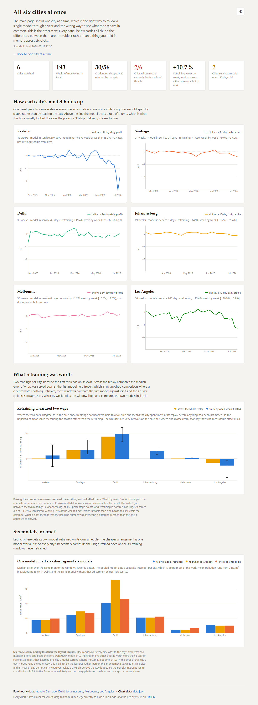
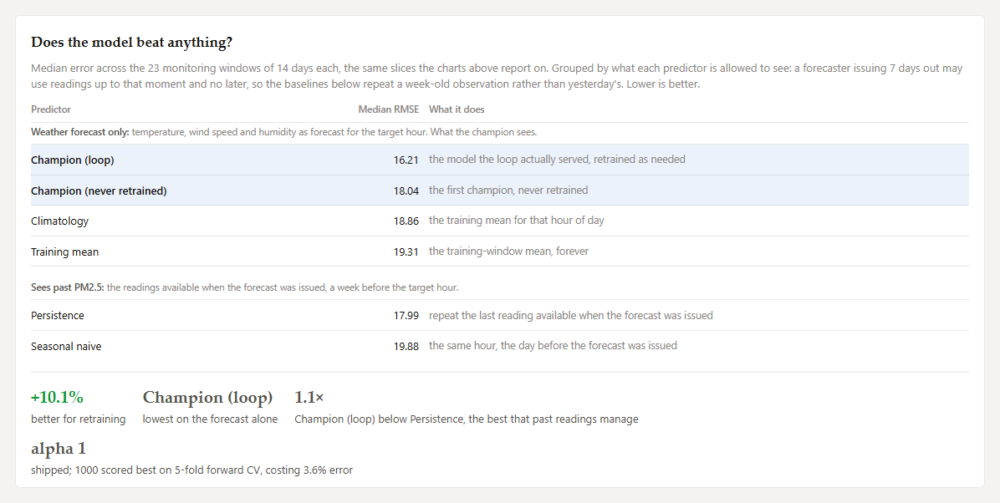
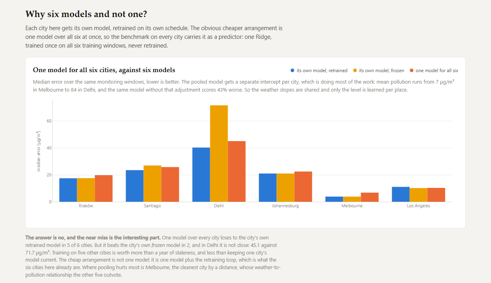
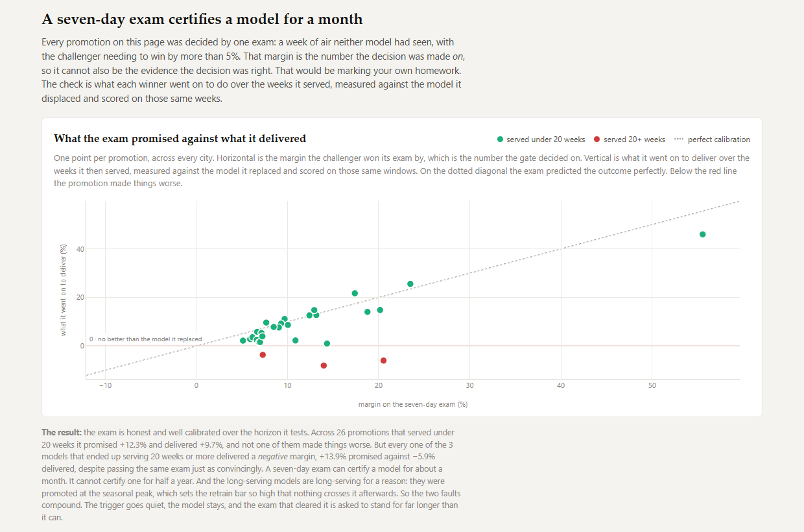
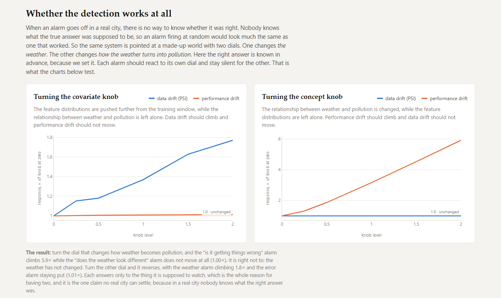

# Evaluation of the loop as it first shipped

This is the analysis of the loop as it ran until 2026-11-10, with ridge at the
library-default penalty and one retrain alarm. The current reading is
[evaluation.md](evaluation.md). This page is kept, with every figure still checked against
that loop's outputs, as the record of what was first claimed and why the loop changed.
"The loop" and "shipped" below mean the first loop.

## Six cities that disagree

Weather forecasts from the [Open-Meteo](https://open-meteo.com/) historical forecast
archive, joined by hour with PM2.5 from its air-quality API, which serves CAMS model output
and not station measurements ([methodology](methodology.md#the-prediction-task)). Each city
trains on a clean season and is replayed week by week into its dirty season and out again.
PM2.5 and error are in µg/m³.

| | span | PM2.5 swing | model error, start → worst | weeks | retrains | shipped |
|---|---|---|---|---|---|---|
| **Delhi** | May 25 → Jul 26 | 42 → 127, post-monsoon burning | 33.4 → 99.0 | 39<!--fig:first.delhi.weeks--> | 9<!--fig:first.delhi.retrains--> | 8<!--fig:first.delhi.promotions--> |
| **Santiago** | Oct 25 → Jul 26 | 18 → 94, winter inversion in a basin | 6.2 → 68.3 | 21<!--fig:first.santiago.weeks--> | 13<!--fig:first.santiago.retrains--> | 7<!--fig:first.santiago.promotions--> |
| **Kraków** | May 25 → Jul 26 | 8 → 57, winter smog in a basin | 5.1 → 54.5 | 48<!--fig:first.krakow.weeks--> | 14<!--fig:first.krakow.retrains--> | 7<!--fig:first.krakow.promotions--> |
| **Johannesburg** | Nov 25 → Jul 26 | 23 → 87, Highveld coal smoke | 12.0 → 82.3 | 19<!--fig:first.joburg.weeks--> | 11<!--fig:first.joburg.retrains--> | 3<!--fig:first.joburg.promotions--> |
| **Melbourne** | Sep 25 → Jul 26 | 5 → 15, winter wood heaters | 3.8 → 15.0 | 30<!--fig:first.melbourne.weeks--> | 8<!--fig:first.melbourne.retrains--> | 4<!--fig:first.melbourne.promotions--> |
| **Los Angeles** | Sep 25 → Jul 26 | 15 → 29, a mild winter bump | 16.4 → 20.8 | 36<!--fig:first.la.weeks--> | 1<!--fig:first.la.retrains--> | 1<!--fig:first.la.promotions--> |

Retrains and shipped differ because the promotion exam rejects challengers: Johannesburg
trained eleven and promoted three.

What retraining was worth, as percent lower error than the first model never retrained:

| | across the replay | week by week | won |
|---|---|---|---|
| **Delhi** | +43.7% [+28.7, +64.2]<!--fig:first.delhi.replay--> | **+49.4% [+33.7, +61.8]**<!--fig:first.delhi.acted--> | 92% [79, 97]<!--fig:first.delhi.won--> of 38<!--fig:first.delhi.acted.n--> |
| **Santiago** | +16.8% [−0.0, +42.5]<!--fig:first.santiago.replay--> | **+17.3% [+9.0, +37.0]**<!--fig:first.santiago.acted--> | 100% [81, 100]<!--fig:first.santiago.won--> of 16<!--fig:first.santiago.acted.n--> |
| **Kraków** | +0.2% [−57.2, +35.5]<!--fig:first.krakow.replay--> | +6.5% [−15.3, +27.5]<!--fig:first.krakow.acted--> | 72% [58, 83]<!--fig:first.krakow.won--> of 47<!--fig:first.krakow.acted.n--> |
| **Johannesburg** | −0.0% [−0.0, +21.3]<!--fig:first.joburg.replay--> | **+14.9% [+8.7, +21.4]**<!--fig:first.joburg.acted--> | 100% [61, 100]<!--fig:first.joburg.won--> of 6<!--fig:first.joburg.acted.n--> |
| **Melbourne** | +0.1% [−3.1, +6.5]<!--fig:first.melbourne.replay--> | +1.2% [−0.6, +3.0]<!--fig:first.melbourne.acted--> | 70% [52, 84]<!--fig:first.melbourne.won--> of 27<!--fig:first.melbourne.acted.n--> |
| **Los Angeles** | −7.9% [−29.1, +0.4]<!--fig:first.la.replay--> | **−13.4% [−36.9, −3.8]**<!--fig:first.la.acted--> | 29% [16, 45]<!--fig:first.la.won--> of 35<!--fig:first.la.acted.n--> |

95% moving-block bootstrap intervals from
[`scripts/uncertainty.py`](../scripts/uncertainty.py), bold where the interval excludes zero.
Win rates carry Wilson intervals. "Across the replay" compares the two median errors,
unpaired; in a city that promotes late, most weeks compare the first model with itself, which
is why Johannesburg reads 0.0%. "Week by week" compares the two models inside each week a
retrained model was serving, and is the one to trust. Which weeks those are is decided by the
version in service, read from the registry.

### How these six cities were chosen

Picked by hand, in three batches, and no city was ever removed:

| added | commit | cities |
|---|---|---|
| 2026-07-31 | `4d4d8db` | Kraków, the original, and the only one the loop was built against |
| 2026-07-31 | `53d0cca` | Delhi and Los Angeles, chosen as the extremes: the most drift-exposed city available, and one expected to show none |
| 2026-08-01 | `95b6ae1` | Santiago, Johannesburg, Melbourne |

`git log -S<CITY> -- src/driftloop/config.py` reproduces this. It shows that no city was
dropped after its result was seen, and that Los Angeles was added as a control in the same
commit as Delhi. It does not make the six a random sample. They were chosen for contrast,
half peaking in June to August and half in December to January, so they cannot say how often
retraining pays in general. Eighteen candidates were ranked by PM2.5 swing first: Sydney
(1.5×) and São Paulo (1.7×) were too flat, and Kraków (6.9×) outranked Milan, Tuzla and
Katowice.

### What the intervals cost this page

Until 2026-08-11 these numbers were published as bare point estimates. The weeks are not
independent: a monitor window is 14 days and the replay steps 7, so neighbouring windows
share half their hours, and pollution episodes last days to weeks. The intervals therefore
resample contiguous blocks of weeks (Künsch, 1989;
[`driftloop/stats.py`](../src/driftloop/stats.py)).

| | weeks compared | effective n | lag-1 autocorrelation | block length |
|---|---|---|---|---|
| **Delhi** | 38 | 10 | 0.57 | 3 |
| **Santiago** | 16 | 2 | 0.75 | 3 |
| **Kraków** | 47 | 5 | 0.79 | 4 |
| **Johannesburg** | 6 | 5 | 0.08 | 2 |
| **Melbourne** | 27 | 8 | 0.55 | 3 |
| **Los Angeles** | 35 | 3 | 0.85 | 3 |

Kraków's 47 weeks are worth about five independent observations and Los Angeles's 35
about three. Two results do not survive: Kraków's +6.5%<!--fig:first.krakow.acted--> and
Melbourne's +1.2%<!--fig:first.melbourne.acted--> both include zero. Four do, including Los
Angeles's −13.4%<!--fig:first.la.acted-->, which makes the control a result: retraining
measurably hurt it.

#### The block length is a knob, so here is the sweep

Block length is the method's one free parameter. The week-by-week interval at several
lengths, where `L=1` redraws single weeks:

| | L=1 | L=2 | L=3 | L=4 | L=6 | L=8 |
|---|---|---|---|---|---|---|
| **Delhi** | [+41, +57]<!--nofig: printed by scripts/uncertainty.py with its sensitivity flag, not written to outputs/--> | [+35, +58]<!--nofig: printed by scripts/uncertainty.py with its sensitivity flag, not written to outputs/--> | [+34, +62]<!--fig:first.delhi.acted--> | [+27, +62]<!--nofig: printed by scripts/uncertainty.py with its sensitivity flag, not written to outputs/--> | [+20, +63]<!--nofig: printed by scripts/uncertainty.py with its sensitivity flag, not written to outputs/--> | [+18, +63]<!--nofig: printed by scripts/uncertainty.py with its sensitivity flag, not written to outputs/--> |
| **Santiago** | [+10, +37]<!--nofig: printed by scripts/uncertainty.py with its sensitivity flag, not written to outputs/--> | [+9, +37]<!--nofig: printed by scripts/uncertainty.py with its sensitivity flag, not written to outputs/--> | [+9, +37]<!--fig:first.santiago.acted--> | [+9, +37]<!--nofig: printed by scripts/uncertainty.py with its sensitivity flag, not written to outputs/--> | [+9, +37]<!--nofig: printed by scripts/uncertainty.py with its sensitivity flag, not written to outputs/--> | [+10, +37]<!--nofig: printed by scripts/uncertainty.py with its sensitivity flag, not written to outputs/--> |
| **Kraków** | [+4, +18]<!--nofig: printed by scripts/uncertainty.py with its sensitivity flag, not written to outputs/--> | [+3, +25]<!--nofig: printed by scripts/uncertainty.py with its sensitivity flag, not written to outputs/--> | [+3, +27]<!--nofig: printed by scripts/uncertainty.py with its sensitivity flag, not written to outputs/--> | [−15, +28]<!--fig:first.krakow.acted--> | [−49, +28]<!--nofig: printed by scripts/uncertainty.py with its sensitivity flag, not written to outputs/--> | [−49, +28]<!--nofig: printed by scripts/uncertainty.py with its sensitivity flag, not written to outputs/--> |
| **Johannesburg** | [+9, +21]<!--nofig: printed by scripts/uncertainty.py with its sensitivity flag, not written to outputs/--> | [+9, +21]<!--fig:first.joburg.acted--> | [+9, +21]<!--nofig: printed by scripts/uncertainty.py with its sensitivity flag, not written to outputs/--> | — | — | — |
| **Melbourne** | [+0, +3]<!--nofig: printed by scripts/uncertainty.py with its sensitivity flag, not written to outputs/--> | [−1, +3]<!--nofig: printed by scripts/uncertainty.py with its sensitivity flag, not written to outputs/--> | [−1, +3]<!--fig:first.melbourne.acted--> | [−1, +3]<!--nofig: printed by scripts/uncertainty.py with its sensitivity flag, not written to outputs/--> | [−1, +3]<!--nofig: printed by scripts/uncertainty.py with its sensitivity flag, not written to outputs/--> | [−1, +3]<!--nofig: printed by scripts/uncertainty.py with its sensitivity flag, not written to outputs/--> |
| **Los Angeles** | [−23, −4]<!--nofig: printed by scripts/uncertainty.py with its sensitivity flag, not written to outputs/--> | [−25, −4]<!--nofig: printed by scripts/uncertainty.py with its sensitivity flag, not written to outputs/--> | [−37, −4]<!--fig:first.la.acted--> | [−39, +1]<!--nofig: printed by scripts/uncertainty.py with its sensitivity flag, not written to outputs/--> | [−39, +1]<!--nofig: printed by scripts/uncertainty.py with its sensitivity flag, not written to outputs/--> | [−39, −4]<!--nofig: printed by scripts/uncertainty.py with its sensitivity flag, not written to outputs/--> |

Kraków changes its answer: its interval excludes zero up to `L=3` and includes it from
`L=4`. It is the most autocorrelated series (lag-1 0.79), so the longer block is the right
one. Los Angeles touches zero at `L=4` and `L=6`. The other four say the same thing at every
length.

#### Where the bootstrap cannot help

Santiago and Johannesburg won every week they acted in, so every resample does too and
the bootstrap interval collapses to [100, 100]<!--fig:first.santiago.won.bootstrap-->. Win
rates therefore use a Wilson interval: 16 of 16 gives [81, 100]<!--fig:first.santiago.won-->
and 6 of 6 gives [61, 100]<!--fig:first.joburg.won-->. Wilson assumes independent trials, so
it is still too narrow.

#### What is still not corrected

No multiple-comparisons correction is applied. The five sweeps alone are 96 arms and
about 170 interval readings, of which seventeen clear zero. The arms share replays and
promotions, so the independence behind Bonferroni or Benjamini-Hochberg does not hold, and
the sections do not form one family.

Multiplicity weakens positive results and strengthens negative ones, and most conclusions
here are negative. The positive ones it reaches are few:

- the skill floor in Los Angeles, +11.78% [+2.09, +17.17]<!--fig:first.floor.la.-0.50.acted-->,
  one arm of eighteen and the evidence [D1](DECISIONS.md) turns on;
- re-certification in Los Angeles, two arms of twenty-four;
- probation in Kraków, one arm of eighteen.

The confidence gate's harm (five arms of eighteen, all one direction) and the large effects
in Delhi and Santiago are out of its reach.

**The reading rule.** One interval that barely clears zero in a table of eighteen is not a
finding. One that clears it widely, or a whole table that does not, is.

### Every replay starts clear of its own training data

Each city's first run sits at least `monitor_days` after the first model's training
ends. Until 2026-08-06 five cities started 9 to 11 days after training against a 14-day
window, so run 0 scored the model on 3 to 5 days of its own training data and understated
its error by 1.0% (Johannesburg) to 15.2% (Melbourne). No retrain decision changed. The
replays were moved a week later, every number was regenerated, and `tests/test_loop.py`
asserts the gap. Los Angeles moved most: one retrain in 36 weeks where it had three in 37,
and −13.4%<!--fig:first.la.acted--> where it had read −2.8%.

### What a full year exposed

Every replay first stopped at the dirty-season peak, where retraining looked like a
clear win. Run through the return to clean air, it came out worse than never retraining in
Kraków and Delhi. A challenger trained on the previous 45 days sees one season and is wrong
when the year turns. Widening `challenger_train_days` to 180 fixed it:

| | 45-day window | 180-day window |
|---|---|---|
| Delhi, retraining worth | −7.2% | **+43.7%** |
| Delhi, median served error | 77.06 | **40.44** |
| Kraków, retraining worth | −29.6% | +0.2% |
| Kraków, median served error | 22.70 | **17.49** |

Only a full annual cycle showed this.

### The loop has no calendar in it

Santiago, Johannesburg and Melbourne peak in June to August, when Kraków and Delhi are
cleanest, and run on the same settings. Santiago is Kraków's twin half a year out of step,
and both draw retrains off the same thresholds in opposite seasons.

Kraków also shows the two signals are separate. Over 21 weeks from February to July 2026
its weather drifts further from training than anywhere else while the retrain alarm stays
quiet. A loop retraining on weather drift alone would have retrained twenty times there. The
alarm was quiet for the wrong reason, though: see
[The retrain trigger stops measuring staleness](#the-retrain-trigger-stops-measuring-staleness).

The live schedule is the same Kraków data run one cycle at a time. Its tracking store
records that a cycle happened, not what started it.

## Does it beat the baselines?

Every predictor is scored on the same 14-day windows. Persistence and seasonal naive see
the readings available when the forecast was issued; the model sees only the weather
forecast. Median RMSE, µg/m³, lower is better:

| | Delhi | Santiago | Kraków | Johannesburg | Melbourne | Los Angeles |
|---|---|---|---|---|---|---|
| **served model** | **40.44** | 24.54 | 17.49 | **21.13** | **3.97** | 10.91 |
| never retrained | 71.85 | 29.51 | 17.52 | 21.13 | 3.98 | **10.12** |
| one model, all six cities | 46.14 | 27.61 | 19.79 | 22.50 | 6.79 | 10.13 |
| climatology | 43.81 | 28.23 | 17.86 | 22.03 | 4.25 | 10.68 |
| training mean | 46.50 | 28.16 | 18.40 | 23.76 | 4.13 | 10.44 |
| persistence | 52.23 | 20.85 | **16.80** | 29.11 | 5.43 | 13.80 |
| seasonal naive | 49.72 | **20.19** | 18.56 | 30.56 | 5.12 | 14.34 |

The model is best in Delhi, Johannesburg and Melbourne and beats persistence in four of
six. Delhi's never-retrained model ends worse than a constant. In Santiago the baselines that
see recent air win.

### Six models, and whether one would do

One ridge over all six cities, trained once with an intercept per city, loses to the
city's own retrained model in five of six and beats the city's own never-retrained model in
two (Delhi: 46.14 against 71.85 µg/m³). Without the per-city intercept it scores 43% worse.
It hurts most in Melbourne.

`alpha=1.0` shipped. Cross-validation wanted up to 1000 in most cities, and the tuned
setting beat the default by 0.1% to 11.9% depending on the city.

## What the model is worth

RMSE has no scale across cities or seasons, and R² divides by the window's own variance,
which in a calm fortnight is tiny (−5.93 in Kraków's last window). So the page leads with
skill against the hour-of-day profile of the previous 30 days, ending a forecast lead before
the window. That baseline sees recent PM2.5 and the model does not, so it is a hard bar.

The models beat it in the dirty season and lose in the clean one: Kraków runs at +43% skill
in January and −167% in July. In Kraków's final window the retrain alarm reads 0.28, its
healthiest, while skill reads −1.67, its worst.

## The retrain trigger stops measuring staleness

`perf_drift_ratio` divides the model's current error by its own error at training time,
and every promotion resets the denominator. Retrains fire in the dirty season, so each new
model inherits a higher bar. The bar sometimes steps down (once in Kraków, three times in
Delhi) but ends far above where it started:

| | baseline, first → last | last retrain | runs of silence after it | highest ratio in those runs |
|---|---|---|---|---|
| **Los Angeles** | 9.7 → 18.3 | run 1 of 36 | **35** | 1.14 |
| **Kraków** | 3.7 → 45.8 | run 18 of 48 | **30** | 0.99 |
| **Delhi** | 18.8 → 57.1 | run 33 of 39 | 6 | 1.07 |
| **Santiago** | 6.7 → 52.7 | run 18 of 21 | 3 | 0.84 |

Once the bar reaches the seasonal peak the alarm cannot fire. Kraków spends 62% of its
replay in that state, serving a 210-day-old model.

## Fixing the trigger: one fix is impossible, the other pays in one city

**An absolute error floor cannot be one number for every city.** Waking Los Angeles
needs a floor near 20 µg/m³, and at 20 Delhi fires on every run and Johannesburg on 68%.

**A floor on skill can.** `LoopConfig.skill_floor` retrains when skill against the 30-day
profile falls below a floor, which no promotion can move.
[`sweep_skill_floor.py`](../scripts/sweep_skill_floor.py) replays all six cities per floor.
Kraków's longest silence falls from 30 weeks to 5 and Los Angeles's from 35 to 12. Median
error, µg/m³:

| | trigger off | skill < 0 | skill < −0.25 | skill < −0.5 |
|---|---|---|---|---|
| **Kraków** | **17.49** | 18.79 | 18.55 | 17.49 |
| **Delhi** | **40.44** | 44.11 | 44.91 | 40.44 |
| **Los Angeles** | 10.91 | **10.15** | 10.45 | **10.15** |
| **Santiago** | 24.54 | 24.54 | 24.54 | 24.54 |
| **Johannesburg** | 21.13 | 21.13 | 21.13 | 21.13 |
| **Melbourne** | 3.97 | 3.97 | 3.97 | 3.97 |

At −0.5 it changes nothing in five cities: Kraków fires six extra retrains and the exam
rejects all six.

#### What the medians were hiding, in both directions

Each arm replays the same weeks as the off arm, so the comparison is paired. Most weeks
are exact ties, so each arm is read twice: over every week, and over the weeks it changed
the serving model.

| | floor | weeks it acted | over every week | over the weeks it acted |
|---|---|---|---|---|
| **Kraków** | skill < 0 | 30<!--fig:first.floor.krakow.+0.00.differing--> of 47 | +0.00% [−11.48, +0.00]<!--fig:first.floor.krakow.+0.00.all--> | −10.82% [−19.47, +1.77]<!--fig:first.floor.krakow.+0.00.acted--> |
| **Kraków** | skill < −0.25 | 17<!--fig:first.floor.krakow.-0.25.differing--> of 47 | +0.00% [−4.96, +0.00]<!--fig:first.floor.krakow.-0.25.all--> | **−23.98% [−39.40, −5.48]**<!--fig:first.floor.krakow.-0.25.acted--> |
| **Kraków** | skill < −0.5 | 0 | identical | — |
| **Delhi** | skill < 0 | 24<!--fig:first.floor.delhi.+0.00.differing--> of 38 | +0.00% [−6.73, +0.00]<!--fig:first.floor.delhi.+0.00.all--> | −5.29% [−15.14, +2.31]<!--fig:first.floor.delhi.+0.00.acted--> |
| **Delhi** | skill < −0.25 | 18<!--fig:first.floor.delhi.-0.25.differing--> of 38 | +0.00% [−6.73, +0.00]<!--fig:first.floor.delhi.-0.25.all--> | **−9.05% [−15.82, −4.44]**<!--fig:first.floor.delhi.-0.25.acted--> |
| **Delhi** | skill < −0.5 | 0 | identical | — |
| **Santiago** | skill < 0 | 6<!--fig:first.floor.santiago.+0.00.differing--> of 20 | +0.00% [+0.00, +0.65]<!--fig:first.floor.santiago.+0.00.all--> | **+3.42% [+0.19, +6.72]**<!--fig:first.floor.santiago.+0.00.acted--> |
| **Los Angeles** | skill < 0 | 31<!--fig:first.floor.la.+0.00.differing--> of 35 | **+11.45% [+1.04, +17.22]**<!--fig:first.floor.la.+0.00.all--> | **+11.78% [+2.89, +18.38]**<!--fig:first.floor.la.+0.00.acted--> |
| **Los Angeles** | skill < −0.25 | 31<!--fig:first.floor.la.-0.25.differing--> of 35 | **+10.26% [+0.44, +16.35]**<!--fig:first.floor.la.-0.25.all--> | **+11.48% [+2.09, +17.29]**<!--fig:first.floor.la.-0.25.acted--> |
| **Los Angeles** | skill < −0.5 | 25<!--fig:first.floor.la.-0.50.differing--> of 35 | +2.49% [+0.00, +15.01]<!--fig:first.floor.la.-0.50.all--> | **+11.78% [+2.09, +17.17]**<!--fig:first.floor.la.-0.50.acted--> |

Johannesburg and Melbourne never changed. Bold clears zero. At −0.25 the floor makes
Kraków 24% worse and Delhi 9% worse in the weeks it acts, which the median table did not
show.

#### The conservative floor is a free improvement, and that reverses the decision

At −0.5 the error series are identical in five cities, and Los Angeles improves in the
25 weeks it acts. Over all 35 weeks Los Angeles reads
+2.49% [+0.00, +15.01]<!--fig:first.floor.la.-0.50.all-->, which touches zero. The default
stayed `None` at the time, as a decision not yet taken ([D1](DECISIONS.md)). Firing more
often mostly sends more challengers to an exam that certifies for about five weeks: at the
lower floors Delhi's promotions go from 8 to 13 and its error rises.

### Verified against other measures and fixed baselines

The three cities that move were re-scored with mean RMSE and median MAE, and against
fixed baselines. The first three columns are ratios to the city's own off arm (above 1 is
worse). The baseline columns are served error over the baseline's (below 1 the model wins).

| | floor | median RMSE | mean RMSE | median MAE | vs. climatology | vs. persistence | vs. training mean |
|---|---|---|---|---|---|---|---|
| **Kraków** | skill < 0 | ×1.074 | ×1.032 | ×1.074 | 0.965 → 1.037 | 1.041 → 1.118 | 0.950 → 1.021 |
| | skill < −0.5 | ×1.000 | ×1.000 | ×1.000 | unchanged | unchanged | unchanged |
| **Delhi** | skill < 0 | ×1.091 | ×1.021 | ×1.044 | 0.973 → 1.061 | 0.774 → 0.844 | 0.870 → 0.949 |
| | skill < −0.5 | ×1.000 | ×1.000 | ×1.000 | unchanged | unchanged | unchanged |
| **Los Angeles** | skill < 0 | ×0.930 | ×0.898 | ×0.861 | 1.010 → 0.939 | 0.791 → 0.735 | 1.045 → 0.972 |
| | skill < −0.5 | ×0.930 | ×0.938 | ×0.874 | 1.010 → 0.939 | 0.791 → 0.735 | 1.045 → 0.972 |

All three statistics agree in direction. At skill < 0 Kraków goes from beating a
constant to losing to one, and Los Angeles crosses the other way at both floors.

## A seven-day exam certifies a model for a month, not half a year

Every promotion left a prediction: its exam margin.
[`retrospect.py`](../src/driftloop/retrospect.py) rebuilds each registered model and
measures what the winner then delivered against the model it replaced, from the run after
the promotion. 28 promotions:

| promotions that served | n | exam promised | delivered | harmful |
|---|---|---|---|---|
| under 20 weeks | 25<!--fig:first.gate.short.n--> | +12.4% [+9.2, +16.9]<!--fig:first.gate.short.exam--> | **+9.8% [+6.4, +14.0]**<!--fig:first.gate.short.delivered--> | 0<!--fig:first.gate.short.harmful--> / 25<!--fig:first.gate.short.n--> [0%, 13%]<!--fig:first.gate.short.harmful_rate--> |
| 20 weeks or more | 3<!--fig:first.gate.long.n--> | +14.4%<!--fig:first.gate.long.exam-->, unbounded | **−6.1%**<!--fig:first.gate.long.delivered-->: −8.0%, −6.7%, −3.6% | 3<!--fig:first.gate.long.harmful--> / 3<!--fig:first.gate.long.n--> [44%, 100%]<!--fig:first.gate.long.harmful_rate--> |

Under 20 weeks the exam is close to honest and no promotion left its city worse off. All
three that served 20 weeks or more delivered a negative margin. Three is too few for an
interval or an effect size, and the 20-week split (`GATE_LONG_WEEKS`) was chosen after
seeing the data. Those models served long because they were promoted at the seasonal peak,
which is also what silenced the alarm.

### Lengthening the exam does not fix it

[`sweep_holdout.py`](../scripts/sweep_holdout.py) replays all six cities at exams of 7,
10, 14 and 21 days:

| exam | served < 20 weeks | promised | delivered | | served ≥ 20 weeks | promised | delivered | harmful |
|---|---|---|---|---|---|---|---|---|
| **7 days** | 25 | +12.4% | +9.8% | | 3 | +14.4% | −6.1% | 3 of 3 |
| **10 days** | 23 | +12.9% | +10.8% | | 3 | +10.8% | −2.7% | 3 of 3 |
| **14 days** | 25 | +10.7% | +8.9% | | 3 | +13.1% | −7.2% | 3 of 3 |
| **21 days** | 20 | +12.1% | +11.8% | | 3 | +13.9% | −9.7% | 3 of 3 |

A longer exam promises more honestly over short service (the gap falls from 2.6 points
to 0.3) and changes nothing beyond it: every long-serving promotion is still harmful. No
exam taken at promotion can certify against drift that has not happened yet. A longer exam
also promotes less, in Delhi 39% of challengers against 89%. Median error over the runs
every arm shares:

| | 7 days | 10 days | 14 days | 21 days |
|---|---|---|---|---|
| **Kraków** | 17.67 | **16.76** | 17.62 | 17.51 |
| **Delhi** | 40.91 | 40.76 | 40.91 | 42.64 |
| **Santiago** | **25.59** | 25.96 | 27.61 | 28.39 |
| **Los Angeles** | **10.78** | 10.98 | 10.95 | 11.12 |
| **Johannesburg** | 21.32 | 21.32 | 21.32 | 21.32 |
| **Melbourne** | **4.08** | 4.10 | 4.09 | 4.09 |

#### And none of those gaps is distinguishable from zero

Each longer exam against seven days, week by week over the runs they share:

| | 10 days | 14 days | 21 days |
|---|---|---|---|
| **Kraków** | +0.96% [−2.06, +8.58]<!--fig:first.holdout.krakow.10d.all--> | −0.14% [−1.11, +0.23]<!--fig:first.holdout.krakow.14d.all--> | −0.27% [−2.42, +0.37]<!--fig:first.holdout.krakow.21d.all--> |
| **Delhi** | −0.17% [−2.06, +0.29]<!--fig:first.holdout.delhi.10d.all--> | −0.48% [−1.37, +0.12]<!--fig:first.holdout.delhi.14d.all--> | −1.77% [−6.06, +0.35]<!--fig:first.holdout.delhi.21d.all--> |
| **Santiago** | −0.12% [−0.97, +0.20]<!--fig:first.holdout.santiago.10d.all--> | −0.12% [−4.73, +0.00]<!--fig:first.holdout.santiago.14d.all--> | −3.19% [−6.72, +0.00]<!--fig:first.holdout.santiago.21d.all--> |
| **Johannesburg** | 0.00% [−1.06, +0.00]<!--fig:first.holdout.joburg.10d.all--> | 0.00% [+0.00, +0.00]<!--fig:first.holdout.joburg.14d.all--> | 0.00% [−9.49, +0.00]<!--fig:first.holdout.joburg.21d.all--> |
| **Melbourne** | −0.05% [−0.29, +0.02]<!--fig:first.holdout.melbourne.10d.all--> | −0.24% [−1.60, +0.89]<!--fig:first.holdout.melbourne.14d.all--> | −1.02% [−1.60, +0.60]<!--fig:first.holdout.melbourne.21d.all--> |
| **Los Angeles** | +3.70% [−1.94, +14.76]<!--fig:first.holdout.la.10d.all--> | +3.43% [−2.55, +15.49]<!--fig:first.holdout.la.14d.all--> | +3.10% [−2.82, +13.53]<!--fig:first.holdout.la.21d.all--> |

None of the eighteen clears zero. Seven days stays. Neither a more sensitive alarm nor a
longer exam pays, which pointed at re-examining the serving model on a schedule.

## Re-certification bounds staleness, and staleness was not the thing that hurt

`LoopConfig.recertify_days` re-sits the exam when the serving model's certificate
expires, whatever the drift signals say.
[`sweep_recertify.py`](../scripts/sweep_recertify.py) replays all six cities at 14, 28, 35
and 56 days.

### First, it does what it says

On the shipped settings:

| | longest silence | oldest certificate |
|---|---|---|
| **Los Angeles** | 35 of 36 runs | **252 days** |
| **Kraków** | 30 of 48 runs | 217 days |
| **Delhi** | 21 of 39 runs | 161 days |
| **Melbourne** | 15 of 30 runs | 140 days |
| **Johannesburg** | 3 of 19 runs | 101 days |
| **Santiago** | 3 of 21 runs | 44 days |

Every cadence bounds the oldest certificate to the cadence, in every city.

### Then, it changes almost nothing

Against the shipped loop, over the weeks each arm changed the serving model:

| | 14 days | 28 days | 35 days | 56 days |
|---|---|---|---|---|
| **Los Angeles** | **+13.8% [+2.9, +20.1]**<!--fig:first.recertify.la.14d.acted--> | **+6.4% [+2.1, +10.9]**<!--fig:first.recertify.la.28d.acted--> | +11.3% [−0.5, +18.4]<!--fig:first.recertify.la.35d.acted--> | +2.5% [−9.0, +9.4]<!--fig:first.recertify.la.56d.acted--> |
| **Delhi** | −6.8% [−15.8, +2.3]<!--fig:first.recertify.delhi.14d.acted--> | (3 weeks) | **−10.8% [−18.9, −7.7]**<!--fig:first.recertify.delhi.35d.acted--> | unchanged |
| **Kraków** | −4.0% [−12.4, +1.4]<!--fig:first.recertify.krakow.14d.acted--> | unchanged | −6.7% [−31.4, +1.1]<!--fig:first.recertify.krakow.35d.acted--> | unchanged |
| **Santiago** | +2.9% [−0.6, +6.7]<!--fig:first.recertify.santiago.14d.acted--> | −0.1% [−0.2, +6.0]<!--fig:first.recertify.santiago.28d.acted--> | unchanged | unchanged |
| **Johannesburg** | unchanged | unchanged | unchanged | unchanged |
| **Melbourne** | unchanged | unchanged | unchanged | unchanged |

"Unchanged" means the two error series are identical. Three of twenty-four comparisons
clear zero: two gains in Los Angeles, the city with the fewest effective observations, and
one loss in Delhi. Every arm trains more (Kraków 14 to 34).

### Why the extra exams do not help

The effect is entirely the extra promotions. Kraków at 28 days fires seven extra times,
the exam rejects all seven and nothing changes; at 35 days one passes and the city ends 6.7%
worse. Re-certification does not fix the exam's calibration. It uses it more often.

### What the three experiments say together

The skill floor and re-certification help Los Angeles and leave most cities identical.
The longer exam helps nowhere. Where retraining pays, the alarm already fires often enough.
The limit is the exam, which cannot certify beyond about five weeks.

## The gate decides on a point estimate, and making it decide on an interval is worse

### The gate is measurably deciding on noise

The exam compares two RMSEs on one week of autocorrelated hours. Resampling each
promotion's exam margin in 24-hour blocks, over the 28 promotions, 11 have an interval
reaching below the 5% margin and 6 reach below zero. Los Angeles's single promotion scored
+21.9% on an interval of [−6.9, +32.3]<!--nofig: recorded in the docstring of scripts/sweep_promotion_confidence.py; no output file holds a per-promotion exam interval--> and delivered −6.7%. Median
exam-interval width:

| retraining pays | width | retraining does not | width |
|---|---|---|---|
| Johannesburg | 4.9 pts | Kraków | 8.8 pts |
| Delhi | 5.7 pts | Melbourne | 15.1 pts |
| Santiago | 6.7 pts | **Los Angeles** | **39.2 pts** |

Where the seasonal swing is large the difference between two models over a week is
signal; where the air is flat it is noise. So "retraining pays where the world moved" is
partly a statement about the exam's precision.

### Requiring the interval to clear the bar does not help. It hurts

`LoopConfig.promotion_confidence` makes the challenger clear the margin at the lower
bound too. [`sweep_promotion_confidence.py`](../scripts/sweep_promotion_confidence.py)
replays all six cities at 0.80, 0.90 and 0.95.

| against the shipped gate, over the weeks it changed the serving model | 0.80 | 0.90 | 0.95 |
|---|---|---|---|
| **Kraków** | **−3.1%** | **−3.1%** | **−2.8%** |
| **Delhi** | unchanged | **−3.9%** | **−3.9%** |
| **Santiago** | unchanged | −1.0% | −1.0% |
| **Melbourne** | unchanged | −7.8% | −1.1% |
| **Los Angeles** | unchanged | +3.5% | +3.2% |
| **Johannesburg** | unchanged | unchanged | unchanged |

Bold clears zero. Five of 18 arms do, and all five are harmful.

### Why a stricter gate makes the winner's curse worse

The gap between promise and delivery widens in four of six cities:

| promise minus delivery | off | 0.80 | 0.90 | 0.95 |
|---|---|---|---|---|
| **Kraków** | 4.4 | 5.3 | 5.3 | **5.7** |
| **Delhi** | 3.1 | 3.1 | 5.0 | **5.0** |
| **Los Angeles** | 28.6 | 28.6 | 24.8 | **39.8** |
| **Melbourne** | 3.4 | 3.4 | 5.4 | **3.8** |
| Santiago | 4.6 | 4.6 | 2.7 | 2.7 |
| Johannesburg | 0.6 | 0.6 | 0.6 | 0.6 |

Blocking a promotion defers it: the alarm keeps firing and a later challenger is judged.
Los Angeles ends with one promotion at every setting, after going from 1 retrain to 6. The
challenger that clears a higher bar does so by a rarer fluctuation. The problem is optional
stopping: the loop sits the exam until something passes.

### A prediction that was wrong, and why

Before the run, removing the 11 promotions whose interval failed was expected to take
Los Angeles from −13.4%<!--fig:first.la.acted--> toward zero. It lands at −10.3% and −12.9%.
The estimate assumed a fixed history, and blocking a promotion changes which models exist
afterwards. That is why every sweep runs a full replay per arm.

## Making the promotion reversible, and why that does not rescue it either

`LoopConfig.probation_days` makes a promotion provisional: after the window the new
model is scored against the one it replaced on a fortnight after both, and is rolled back
if worse. It is a check, not a selection.
[`sweep_probation.py`](../scripts/sweep_probation.py) replays all six cities at 14, 21 and
28 days.

### It is the first mechanism that does no harm

| against the shipped loop, over the weeks it changed the serving model | 14 days | 21 days | 28 days |
|---|---|---|---|
| **Kraków** | unchanged | **+1.5% [+0.8, +2.0]**<!--fig:first.probation.krakow.21d.acted--> | +0.8% |
| **Delhi** | +1.1% (2 weeks) | unchanged | unchanged |
| **Los Angeles** | +4.0% | unchanged | unchanged |
| **Santiago** | unchanged | +0.6% (1 week) | unchanged |
| **Melbourne** | −0.1% | unchanged | −0.3% |
| **Johannesburg** | unchanged | unchanged | unchanged |

One of 18 arms clears zero, and it is positive. One in eighteen is what chance produces
([what is still not corrected](#what-is-still-not-corrected)), and it rests on one rollback
over seven weeks. Read it as "does no damage".

### The diagnostic is worth more than the outcome

The mean verdict is positive in 17 of 18 arms and 8 of 49 judged promotions were rolled
back: promotions are mostly fine inside the first month, which matches the exam
calibration. A window short enough to isolate one promotion finds little wrong. One long
enough to reach the failure cannot tell a bad promotion from a world that moved.

### A fortnight cannot resolve the difference it is asked about

Los Angeles's one promotion, judged at three windows:

| judged at | verdict | outcome |
|---|---|---|
| 14 days | −ve, **rolled back** | paired retraining −13.4% → −9.2% |
| 21 days | +1.3%, kept | unchanged |
| 28 days | +4.5%, kept | unchanged |

The same promotion gets opposite decisions. Probation is safe, cheap and unproven.

## Whether the detection works at all

A real city's drift has no known cause. The simulated city has two knobs that move the
weather and the weather-to-pollution relationship separately:

| knob turned 0 → 2 | data drift (PSI) | performance drift |
|---|---|---|
| **covariate** (feature distributions shift) | **1.77×** | 1.01× |
| **concept** (the relationship changes) | 1.00× | **5.92×** |

Each alarm responds to its own cause only.

## Is the finding about the world, or about a linear model?

A straight line can follow a season only by being refitted, which would look like
retraining paying off. [`ablate_model.py`](../scripts/ablate_model.py) replays Delhi and
Los Angeles under three models.

### Three arms, because two were not a fair test

The shipped ridge ran at `alpha=1.0`, which its own sweep beat by 11.9% in Delhi, and a
tree at library defaults is undertrained. So both are tuned on the first model's training
window with the same folds, and the shipped ridge stays as a third arm.

| tuned on the bootstrap window | Delhi CV RMSE | Los Angeles CV RMSE |
|---|---|---|
| Ridge, shipped `alpha=1` | 31.63 | 8.18 |
| Ridge, tuned | **28.27** (`alpha=1000`) | **8.01** (`alpha=100`) |
| gradient boosting, library defaults | 37.95 | 9.12 |
| gradient boosting, tuned | **27.90** (+26.5%) | **7.86** (+13.8%) |

### The tuned tree is a stump, which is itself the answer

Extending the grid kept moving the best tree to its most regularised corner, until
`max_leaf_nodes` reached 2 at a learning rate of 0.01: an additive model of stumps, with no
feature interactions.

### Both checks pass, and the headline does not survive intact

| | model | median RMSE | retrains | promoted | retraining premium |
|---|---|---|---|---|---|
| **Delhi** | Ridge, shipped | 40.44<!--fig:first.ablation.delhi.ridge.rmse--> | 9 | 8 | **+49.35% [+33.74, +61.81]**<!--fig:first.ablation.delhi.ridge--> |
| **Delhi** | Ridge, tuned | 40.11<!--fig:first.ablation.delhi.ridge_tuned.rmse--> | 8 | 8 | **+27.73% [+14.99, +40.59]**<!--fig:first.ablation.delhi.ridge_tuned--> |
| **Delhi** | gradient boosting, tuned | **39.91**<!--fig:first.ablation.delhi.gbm_tuned.rmse--> | 7 | 5 | **+9.74% [+7.97, +25.96]**<!--fig:first.ablation.delhi.gbm_tuned--> |
| **Los Angeles** | Ridge, shipped | 10.91<!--fig:first.ablation.la.ridge.rmse--> | 1 | 1 | **−13.36% [−36.88, −3.81]**<!--fig:first.ablation.la.ridge--> |
| **Los Angeles** | Ridge, tuned | 10.76<!--fig:first.ablation.la.ridge_tuned.rmse--> | 1 | 1 | **−12.78% [−33.58, −3.28]**<!--fig:first.ablation.la.ridge_tuned--> |
| **Los Angeles** | gradient boosting, tuned | **10.74**<!--fig:first.ablation.la.gbm_tuned.rmse--> | 1 | 1 | −6.93% [−13.20, +2.83]<!--fig:first.ablation.la.gbm_tuned--> |

The shipped arm reproduces the published figures, and the tuned tree is the better
model, by 0.20 µg/m³ in Delhi and 0.02 in Los Angeles. Delhi's premium falls from
+49.35%<!--fig:first.ablation.delhi.ridge--> to +9.74%<!--fig:first.ablation.delhi.gbm_tuned-->;
over the 37 weeks both retrained, the paired difference is
+13.92 points [+8.01, +16.69]<!--fig:first.ablation.delhi.ridge_minus_gbm-->. Los Angeles's
harm falls to −6.93%<!--fig:first.ablation.la.gbm_tuned--> and stops clearing zero.

### Where the premium actually goes

| Delhi's +49.35%<!--fig:first.ablation.delhi.ridge--> | points |
|---|---|
| lost by tuning `alpha`, same model class | **21.62**<!--fig:first.ablation.delhi.alpha_points--> |
| lost by leaving linearity | **17.99**<!--fig:first.ablation.delhi.linearity_points--> |
| **left over** | **+9.74%**<!--fig:first.ablation.delhi.gbm_tuned--> |

The largest part was the under-regularised ridge, not the model class: retraining was
partly compensating for a hyper-parameter. That is what led to tuning the penalty at every
fit. Los Angeles: 0.58 points from `alpha`, 5.85 from linearity.

### What this changes, and what survives

Retraining still pays in Delhi under the best model, at about a fifth of the first
figure. Los Angeles's harm holds for the shipped model and not for the tuned tree.

### What it still does not establish

Hyper-parameters were chosen on the first training window (1,296 to 1,848 rows) and
used for 180-day challengers. Both tuned models sit close to a constant under this
cross-validation (29.47 against 28.27 in Delhi). And this is two cities.

## Two faults found and fixed during this analysis

- **Fixed 2026-08-06.** Run 0 scored the first model partly on its own training data in
  five cities ([above](#every-replay-starts-clear-of-its-own-training-data)).
- **Fixed 2026-08-05.** `run_simulation` required `step_days >= holdout_days`. The correct
  condition is `step_days + holdout_days >= monitor_days`, now enforced with a test on each
  side. No shipped configuration was affected.
