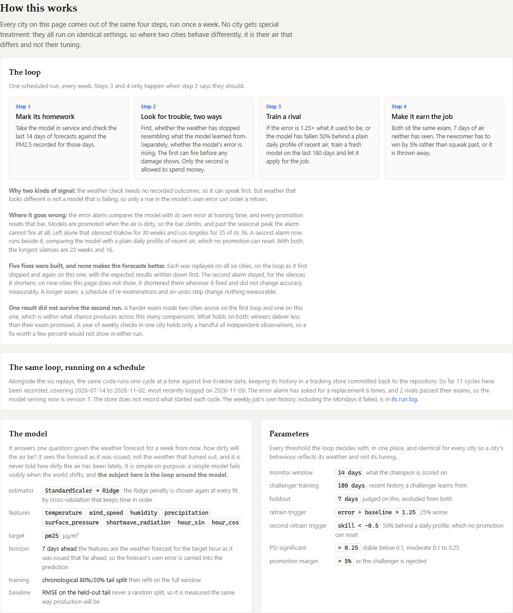

# Methodology

How the loop works. For whether it works, see [evaluation.md](evaluation.md).

A linear model forecasts a city's hourly PM2.5 a week ahead from the weather
forecast. Once a week a loop scores that model on the fortnight just gone, checks
for drift, trains a replacement when the model's error says so, and promotes the
replacement only if it wins an exam on data neither model has seen. This page
follows one weekly run, then covers how the results are judged.

## Vocabulary

| term | meaning |
|---|---|
| **champion** | the model in service, pointed at by the `champion` alias in the MLflow registry |
| **challenger** | a freshly trained model competing to replace it |
| **promotion** | moving the `champion` alias onto a challenger, which is the deployment step |
| **monitor window** | the 14 days ending at the run date, used to score the champion and measure drift |
| **holdout** | the last 7 days before the run date, kept out of challenger training and used as the exam |
| **forecast lead** | how far ahead the inputs look: at lead 7 they are the forecast issued a week before the target hour |
| **covariate drift** | the incoming weather no longer looks like the training weather; needs no recorded outcomes |
| **concept drift** | the link between weather and pollution has changed; visible only in the model's error |
| **PSI** | Population Stability Index, the statistic used for covariate drift |
| **skill** | error relative to a reference predictor: `1 − RMSE_model / RMSE_reference` |
| **replay** | running the weekly loop over a fixed historical span, one week at a time |

---

## The prediction task

Hourly PM2.5 concentration in µg/m³, seven days ahead.

**The target is a model's estimate, not a measurement.** Open-Meteo's air-quality
API serves the Copernicus Atmosphere Monitoring Service (CAMS): the European
domain for Kraków, the global domain for the other five cities. No station
reading enters the project. So the loop learns to predict another model's account
of the air, and a change in how CAMS produces that account would move the target
just as a change in the air would. Nothing here separates the two.

The inputs are the weather forecast for the target hour as it stood a week
earlier, from Open-Meteo's archive of previous model runs. That archive holds
what the forecast said at the time, not what the weather turned out to be, so the
model answers a question a city could ask on a Monday: given the weather expected
next Monday, how dirty will the air be? At that lead the weather forecast is
already off by about 4.5 °C on temperature, and the PM2.5 model inherits that
error before adding its own.

The lead is one constant, `FORECAST_LEAD_DAYS`. Seven is the ceiling, since
Open-Meteo archives previous runs no further. At 0 the same code reads analysed
weather and becomes a same-hour estimator. Nothing after the data fetch knows
which of the two it is doing.

---

## The model



`StandardScaler → Ridge` on eight inputs. It is fitted on the first 80% of a
training window and scored on the last 20%, which gives the **baseline RMSE**
the retrain alarm later compares against, then refitted on the whole window.

**Ridge** is least squares with a penalty on the size of the coefficients:

```
minimise   Σᵢ (yᵢ − β₀ − Σⱼ βⱼxᵢⱼ)²   +   α · Σⱼ βⱼ²
```

The penalty keeps the coefficients from lurching when correlated inputs trade off
against one another, at the price of shrinking them a little (Hoerl and Kennard,
1970). It matters here because every challenger is fitted on a different 180-day
window that nobody inspects first.

**The inputs are standardised first**, because the penalty adds coefficients up
as if they were comparable. Pressure runs near 1000 hPa and precipitation near
0.1 mm, so in raw units the penalty would rank them by recording unit. After
scaling, a coefficient is how far the prediction moves for a typical move in that
input.

**Coefficients are reported in original units.** `model.effective_coefficients`
folds the scaler back in, giving µg/m³ per °C, per m/s, per hPa, which is what the
coefficient charts plot and what makes two versions comparable. It also means a
fitted model is eight slopes and an intercept. Those are written to the registry
as tags, and [`retrospect.py`](../src/driftloop/retrospect.py) rebuilds any
version from them and scores it on any window. Most of the after-the-fact
analysis exists because a linear model fits in nine numbers.

**The model is small on purpose.** A flexible model would score better and would
also absorb some of the drift, and the loop is the subject here. Whether the
findings depend on that choice is tested by replaying two cities under a
gradient-boosted tree
([evaluation.md](evaluation.md#the-model-ablation)).

### Choosing alpha

The loop chooses the penalty `alpha` at every fit, for the first model and for
each challenger: a sweep over a logarithmic grid, scored by five-fold
cross-validation in which every fold trains on earlier hours and is scored on
later ones (`TimeSeriesSplit`). A random split would leak across the fold
boundary on hourly data and make every setting look fine (Bergmeir and Benítez,
2012).

Until 2026-11-10 the loop ran at scikit-learn's default of 1.0. Every city's
first training window wants far more:

| | best α | error cost of the default |
|---|---|---|
| Santiago | 10 | 0.1% |
| Los Angeles | 100 | 2.1% |
| Melbourne | 1000 | 1.4% |
| Kraków | 1000 | 3.6% |
| Johannesburg | 1000 | 4.4% |
| Delhi | 3000 | 12.1% |

Judged by accuracy the default looked harmless. Judged by the headline it
supplied 21.6<!--fig:first.ablation.delhi.alpha_points--> of Delhi's first 49.4<!--fig:first.delhi.acted--> points
([DECISIONS.md](DECISIONS.md), D5). The same table says something about the
model: if shrinking every slope most of the way to zero costs so little, the
relationship it can express is weak.

---

## The features

Six weather inputs, chosen for how pollution builds up and clears, plus the hour
of day.

| input | unit | why it is there |
|---|---|---|
| temperature | °C | cold air under warm air is a lid on the city; also a proxy for the heating season |
| wind_speed | m/s | still air lets pollution build up, moving air carries it away |
| humidity | % | water condenses onto particles and feeds the chemistry that forms new ones |
| precipitation | mm per hour | rain washes particles out; zero for 70% to 96% of hours, depending on the city |
| surface_pressure | hPa | high pressure means sinking air, which caps the city |
| shortwave_radiation | W/m² | sunlight deepens the layer of air that pollution is diluted into |

Boundary layer height, the depth of that layer, would summarise most of these in
one number. Open-Meteo does not archive it at a seven-day lead, so sunlight
stands in for it. Seinfeld and Pandis is the reference for every mechanism above.

**The hour of day** enters as a sine and a cosine, `sin(2π·hour/24)` and
`cos(2π·hour/24)`, which puts 23:00 next to midnight where a raw number would put
them 23 apart. One such pair can express one peak a day, and city pollution
usually has two, morning and evening. A second pair would fix that and has not
been tried.

Only the six weather inputs are checked for drift. The hour cannot drift, since
every monitor window holds all 24 hours.

---

## One weekly run

Four steps, the last two only when the second says so.

```
...........[==== challenger train ====][= holdout =] as_of
                    [====== monitor window ========]
[== champion train ==]  (much earlier, never overlaps holdout)
```

### Step 1: score the champion

The champion predicts the monitor window, and its RMSE, MAE and R² are logged.

### Step 2: two drift signals

| signal | what it measures | needs recorded outcomes? | can order a retrain? |
|---|---|---|---|
| covariate drift (PSI) | the weather changed | no | no |
| performance drift | the model's error rose | yes | yes |

Covariate drift can speak before any error is observable, which makes it the
early warning. It cannot order a retrain, because weather that looks different is
not a model that is failing. Kraków shows the gap: through its summer the weather
drifts far from the training weather while the model's error stays low.

**What PSI computes.** Sort the training window's values for one input into ten
equal buckets, drop the monitor window's values into the same buckets, and
measure how differently they fall:

```
PSI = Σ over buckets  (current_share − reference_share) · ln(current_share / reference_share)
```

The usual reading is below 0.10 stable, 0.10 to 0.25 shifted, above 0.25
different (Siddiqi, 2006).

PSI tops out. A bucket with no current rows adds a fixed amount however far the
weather has moved, so with ten buckets the ceiling is about 11.5, and a January
fortnight set against the previous June is already close to it. Every city sits
above 0.25 on almost every run. So PSI is dependable as a yes or no and not as a
size, and both interfaces show it as a green, amber or red band.

**The error alarm, and why it goes deaf.** A retrain fires when the champion's
RMSE on the monitor window exceeds 1.25× its own baseline RMSE. Every promotion
resets that baseline, and promotions happen when the air is dirty, so the bar
climbs and does not come back down. Past the seasonal peak the alarm cannot fire
whatever the model does
([the full analysis](evaluation-first-loop.md#the-retrain-trigger-stops-measuring-staleness)).

**A second alarm runs beside it.** It fires when the champion's skill against a
plain daily profile of recent air falls below −0.5:

```
retrain if   rmse_now / baseline_rmse > 1.25          (resets at every promotion)
        or   1 − rmse_now / rmse_profile < −0.5        (no promotion can move it)
```

It only ever adds a way to fire, and every run records which alarm fired. It is
kept for what it does to the loop's silences, with no claim about accuracy: on
nine cities outside the six it shortened the silence wherever it fired, and its
effect on accuracy had no consistent sign ([DECISIONS.md](DECISIONS.md), D1).

### Step 3: train a challenger

A challenger trains on the 180 days before the holdout. The window was 45 days
at first, which looks natural and is wrong: a challenger that has seen one season
wins its exam and is mismatched as soon as the year turns. Replays that stopped
at the winter peak hid this, and running them through the recovery exposed it
([HISTORY.md](HISTORY.md)). 180 was chosen to span more than one season and has
not been swept.

### Step 4: the promotion gate

Champion and challenger both predict the holdout, and the challenger is promoted
only if its RMSE is more than 5% lower.

Two guards keep either model from being graded on data it trained on. Within a
run, the loop raises if the holdout would overlap the champion's training data.
Across runs, a replay requires

```
step_days + holdout_days >= monitor_days
```

because a challenger promoted at one run trained up to 7 days before it, and the
next run's monitor window must not reach back into that. Both are asserted in
`tests/test_loop.py`.

The baselines are held to the same rule. A forecaster issuing seven days out may
use readings up to that moment and no later, so persistence repeats a week-old
reading, not yesterday's.

---

## Judging the loop afterwards

The loop logs what it decided, which is enough to run it and not enough to judge
it. Judging needs models scored on weeks they never served: every version on
every window, to see one model age; and the replaced champion on the weeks its
replacement served, to see whether a promotion paid.
[`retrospect.py`](../src/driftloop/retrospect.py) computes both from the
coefficient tags, and `tests/test_retrospect.py` checks the reconstruction
against the RMSE the loop logged at the time.

### The skill score

```
skill = 1 − RMSE_model / RMSE_reference
```

1 is perfect, 0 ties the reference, negative means the reference won (Murphy,
1988). The reference here is a daily profile: the mean for that hour of day over
the previous 30 days. It has no unit, so a dirty city and a clean one can be
compared, and it does not move when a model is promoted.

The profile sees recent PM2.5 and the model never does, so this is a hard bar and
not a like-for-like one. That is intended: the profile is something that could be
deployed in the model's place.

R² is the same formula with the window's own mean as the reference. In a calm
fortnight that mean is hard to beat, so R² goes sharply negative on a small
absolute error. It reflects the window more than the model.

### Three rules about windows

- The daily profile ends a full forecast lead before the window it scores, so
  everything it averages was known when that forecast was issued.
- A promotion's delivered margin starts at the run after the promotion. The
  monitor window at the promotion itself overlaps the challenger's training data.
- A run that promotes monitors with the outgoing champion and is then tagged with
  the winner. `retrospect` keeps both, `serving_version` for what was in service
  and `champion_version` for when a model started.

---

## Serving the champion

The alias is the contract. Nothing in the service pins a version: promote in the
registry, call `POST /reload`, and the new champion is live without a redeploy.

Serving only reads the tracking store. It builds the hour inputs with the same
function training uses, so served inputs cannot differ from trained ones, and it
normalises timestamps to UTC first, because the training data is UTC.
Predictions come back twice: `pm25` floored at zero, and `pm25_raw` as the model
said it.

The Docker image replays the loop from the committed data at build time instead
of copying a tracking store in, because MLflow stores artifact locations as
absolute paths. The rebuild also shows the replay is deterministic.

---

## What is recorded

- **Per run, to MLflow:** the drift readings per input, the champion's error and
  its baseline, the challenger's and champion's error on the holdout when a
  challenger exists, and tags for whether a retrain fired, which alarm fired it
  and what the gate decided. Two artifacts per run hold the predictions and the
  input distributions.
- **Per version, to the registry:** the coefficients as tags, and the `champion`
  alias, moved on promotion.
- **Per city, to the repository:** the hourly data under `data_cache/`, so every
  chart matches a fixed dataset. The weekly Action commits its tracking store
  back so each cycle continues from the last.

---

## Putting an interval on it

Every headline is a statistic over a few dozen weekly windows, and each is
published with a 95% interval from [`stats.py`](../src/driftloop/stats.py).

**The windows are not independent.** A monitor window is 14 days wide and runs
are 7 days apart, so neighbouring windows share half their hours, and a bad week
tends to follow a bad week. An ordinary bootstrap resamples single weeks, loses
that, and reports an interval that is too narrow. The moving-block bootstrap
(Künsch, 1989) resamples runs of consecutive weeks, so the dependence inside a
block survives.

**Two models compared on the same weeks are resampled together**, with the same
blocks, since separating them would compare one model's week 4 with the other's
week 31.

**The block length is the one free choice.** It defaults to the cube root of the
number of windows, between 2 and half the series. The sensitivity of each
interval to that choice is
[published](evaluation-first-loop.md#the-block-length-is-a-knob-so-here-is-the-sweep).

**Where the bootstrap cannot help, it says so.** A city that won every week would
get a false interval of [100, 100]<!--nofig: what the bootstrap would wrongly report, not a result-->, so
win rates use a Wilson interval. Below four observations the interval is
reported as infinite and the values are listed.

No p-values are reported: an interval says how big an effect is and whether it
could be nothing. The seed and the number of resamples are fixed, so a rerun
gives the same interval.

These intervals are still small-sample intervals. A city's replay holds about 2
to 10 independent observations, which is why
[evaluation.md](evaluation.md#limitations) reads "nothing measurable" as not
detectable and never as no effect.

## References

**Uncertainty**

- Künsch, H. R. (1989). *The Jackknife and the Bootstrap for General Stationary
  Observations.* Annals of Statistics, 17(3), 1217–1241.
- Politis, D. N., & Romano, J. P. (1994). *The Stationary Bootstrap.* JASA,
  89(428), 1303–1313.
- Efron, B., & Tibshirani, R. J. (1993). *An Introduction to the Bootstrap.*
  Chapman & Hall.
- Wilson, E. B. (1927). *Probable Inference, the Law of Succession, and
  Statistical Inference.* JASA, 22(158), 209–212.

**Ridge regression and validation on time series**

- Hoerl, A. E., & Kennard, R. W. (1970). *Ridge Regression: Biased Estimation for
  Nonorthogonal Problems.* Technometrics, 12(1), 55–67.
- Hastie, T., Tibshirani, R., & Friedman, J. (2009). *The Elements of Statistical
  Learning*, 2nd ed., §3.4. [Free PDF](https://hastie.su.domains/ElemStatLearn/).
- Bergmeir, C., & Benítez, J. M. (2012). *On the use of cross-validation for time
  series predictor evaluation.* Information Sciences, 191, 192–213.

**Drift, and systems that live with it**

- Gama, J., Žliobaitė, I., Bifet, A., Pechenizkiy, M., & Bouchachia, A. (2014).
  *A Survey on Concept Drift Adaptation.* ACM Computing Surveys, 46(4).
- Widmer, G., & Kubat, M. (1996). *Learning in the Presence of Concept Drift and
  Hidden Contexts.* Machine Learning, 23(1), 69–101.
- Sculley, D., et al. (2015). *Hidden Technical Debt in Machine Learning
  Systems.* NeurIPS.
- Siddiqi, N. (2006). *Credit Risk Scorecards.* Wiley. The origin of PSI and its
  0.10 and 0.25 bands.

**Forecast verification**

- Murphy, A. H. (1988). *Skill Scores Based on the Mean Square Error and Their
  Relationships to the Correlation Coefficient.* Monthly Weather Review, 116(12),
  2417–2424.
- Jolliffe, I. T., & Stephenson, D. B. (2012). *Forecast Verification: A
  Practitioner's Guide in Atmospheric Science*, 2nd ed. Wiley.

**Air quality and the data**

- Seinfeld, J. H., & Pandis, S. N. (2016). *Atmospheric Chemistry and Physics:
  From Air Pollution to Climate Change*, 3rd ed. Wiley.
- WHO (2021). [*Global Air Quality
  Guidelines*](https://www.who.int/publications/i/item/9789240034228).
- [Open-Meteo](https://open-meteo.com/) historical forecast and air-quality APIs,
  and the [MLflow Model Registry](https://mlflow.org/docs/latest/model-registry.html).
